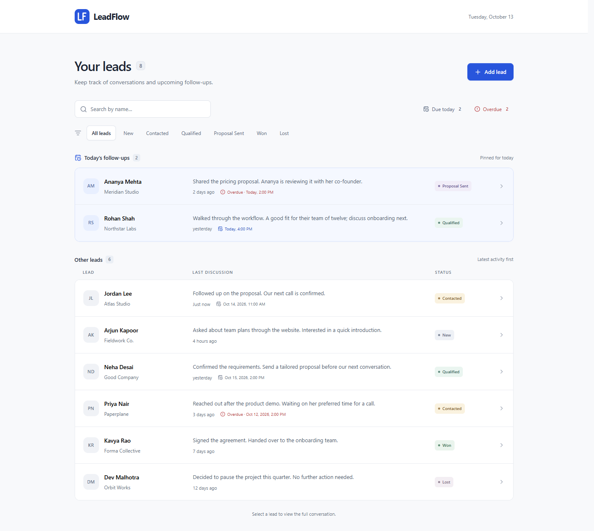

# LeadFlow

[](https://github.com/Abhinav-0311/Leadflow/actions/workflows/checks.yml)

A single-screen CRM for tracking leads, logging discussions, and managing follow-ups. Built for the PravarAI fullstack internship assessment with Next.js, TypeScript, FastAPI, and SQLite.

[Watch the demo](https://youtu.be/Z3dLRpv_MB0)



## Run with Docker

Requires Docker Desktop (Linux containers) or Docker Engine with Compose.

```sh
git clone https://github.com/Abhinav-0311/Leadflow.git
cd Leadflow
docker compose up --build -d
```

Open **http://127.0.0.1:3200**. The API is private to the Compose network; the frontend proxies requests to it. Seven fictional leads and fourteen discussions are added on the first start. The first image build downloads dependencies and can take several minutes.

```sh
docker compose logs --tail 30
docker compose down
```

The named `leadflow-data` volume keeps the database across container restarts and `docker compose down`. Seeding skips any database that already contains a lead. It never resets your records.

## Run locally

Requires **Node.js 24**, **Python 3.12**, and npm. Use two terminals, starting from the repository root. No accounts, API keys, or environment file are needed for the defaults.

**Terminal 1: API, Windows PowerShell**

```powershell
python -m venv .venv
.\.venv\Scripts\python.exe -m pip install -r backend/requirements-dev.txt
cd backend
..\.venv\Scripts\python.exe -m app.seed
..\.venv\Scripts\python.exe -m uvicorn app.main:app --host 127.0.0.1 --port 8000
```

**Terminal 1: API, macOS/Linux**

```sh
python3 -m venv .venv
.venv/bin/python -m pip install -r backend/requirements-dev.txt
cd backend
../.venv/bin/python -m app.seed
../.venv/bin/python -m uvicorn app.main:app --host 127.0.0.1 --port 8000
```

**Terminal 2: frontend, all platforms**

```sh
cd frontend
npm ci
npm run dev
```

Open **http://127.0.0.1:3200**. API documentation is at **http://127.0.0.1:8000/docs**. Omit the seed command to start with an empty workspace.

### Environment variables

All application settings are listed in [`.env.example`](.env.example).

| Variable | Default | Used by |
| --- | --- | --- |
| `API_URL` | `http://127.0.0.1:8000` | Next.js server; set in `frontend/.env.local` or the shell before starting/building |
| `DATABASE_URL` | `sqlite:///./leadflow.db` | API and seed command; set in the shell before running either |

Database paths are relative to the backend working directory. SQLite is the supported database for this assessment. Docker supplies its own database path and internal API URL; it works without an `.env` file. `API_URL` is included in the production rewrites at build time, so rebuild after changing it.

## What works

- Create a lead with a required name and optional company and phone; status starts at New.
- View all leads with their status, latest discussion, and time since that discussion.
- Search by name and filter by all six statuses.
- See today's follow-ups pinned first, ordered by scheduled time, without duplicate rows.
- Open a lead's discussion history in a dialog, newest first.
- Save a note and optionally schedule a follow-up. Both the dialog and the list update from the saved API response.
- Update a lead's status from the dialog and retain it after a refresh or restart.
- Recognize overdue follow-ups by an explicit red “Overdue” label.
- Narrow the list to due-today or overdue follow-ups, combined with name and status filters.
- Mark a follow-up complete from the lead dialog. The current reminder clears immediately while the original discussion and scheduled date stay in history.
- Use the app with a keyboard or at a mobile viewport width.

Forms show saving states, retain drafts when requests fail, and confirm before discarding unsaved work. Empty lists, no search matches, empty timelines, and failed loads each have a relevant next action.

## Behavior and assumptions

- Timestamps are stored and returned in UTC. “Today” means the browser's local calendar day, rather than a rolling 24-hour interval. Input dates are converted from local time to UTC.
- The clock refreshes every thirty seconds and when the window regains focus, keeping the grouping and time labels current.
- A follow-up earlier than the current time is overdue, including an elapsed appointment today. Today's elapsed appointments stay in the pinned section.
- Search and status filters apply to both sections. Other leads are ordered by latest discussion, falling back to creation time. Equal timestamps use IDs for a stable order.
- A new note without a follow-up keeps the existing appointment. A new scheduled follow-up replaces the lead's current appointment; earlier schedules remain visible on their original discussion notes.
- Completing a follow-up clears the current appointment, preserves all discussion history, and leaves any unsaved note in the composer. Completing an already-cleared reminder is safe to repeat.
- Due-today and overdue filter counts respect the current name and status filters. An elapsed appointment today appears in both counts; each lead is still shown once in the list.
- Status changes preserve notes and scheduled dates. Won and Lost remain available in the list and filters.
- Notes are required, trimmed, and limited to 5,000 characters. Names are limited to 120 characters, company names to 160, and phone numbers to 40. Phone is free text to accommodate international formats.
- Demo appointments are generated relative to the seed date in India Standard Time. Browsers in other timezones display those same appointments in their own local time. Re-running seed does not shift existing appointments.

## Structure

```text
backend/
  app/models.py       Database tables and validated request/response schemas
  app/main.py         API, sessions, transactions, error handling
  app/seed.py         Non-destructive fictional demo data
  tests/test_api.py   API and persistence checks
frontend/
  src/app/            Single page, global styles, metadata
  src/components/     Workspace, add-lead dialog, timeline, shared native dialog
  src/lib/            API requests, types, date and grouping functions
  tests/              Date/grouping unit tests and browser flows
docs/screenshots/     Desktop, mobile, and dialog captures
compose.yaml          Frontend, API, persistent database volume
```

The API uses SQLModel's timezone-aware storage and one database transaction for a discussion plus its follow-up. List summaries are fetched with a joined query, avoiding a separate history request per lead. Native browser dialogs provide modal semantics and keyboard focus behavior; no client state library or UI component framework is required.

### API

| Method | Endpoint | Result |
| --- | --- | --- |
| GET | `/api/health` | API and database readiness |
| GET | `/api/leads` | Leads with latest-note summaries |
| GET | `/api/leads/{id}` | One lead with its latest-note summary |
| POST | `/api/leads` | Create a lead (`201`) |
| PATCH | `/api/leads/{id}` | Change status (`200`) |
| DELETE | `/api/leads/{id}/follow-up` | Complete the current follow-up (`200` with updated lead) |
| GET | `/api/leads/{id}/discussions` | Full history, newest first |
| POST | `/api/leads/{id}/discussions` | Save note and optional follow-up (`201`) |

Missing leads return `404`, invalid inputs return `422`, and unexpected failures return a generic `500` message. Client validation improves feedback; the API validates independently.

## Checks

Backend, from `backend/`:

```powershell
..\.venv\Scripts\python.exe -m pytest -q
```

On macOS/Linux, use `../.venv/bin/python -m pytest -q` instead.

Frontend, from `frontend/`:

```sh
npm run test:unit
npm run typecheck
npm run build
npx playwright install chromium
npm test
```

Browser tests start their own API and frontend on ports `18000` and `3100`, using a separate ignored `backend/e2e.db`. They cover the full create → discuss → schedule → change status → reload flow, combined filters, completion, retained drafts, failed requests, load retry, keyboard focus, overdue labels, and mobile overflow. Unit tests cover local-day boundaries and stable grouping. API tests cover validation, persistence, seed safety, timestamp ties, completion history, and transaction rollback.

GitHub Actions runs API tests, grouping tests in UTC and America/Los_Angeles, a production build (including TypeScript), and the desktop/mobile browser suite on pushes to `main` and pull requests. It uses read-only repository permissions and requires no secrets.

Verified on 13 October 2026: 11 API tests, 8 grouping/date tests, and 16 browser tests passed; TypeScript and the production build passed. The Docker build completed the working flow, and an API container restart preserved the new lead, note, status, and follow-up. Manual browser checks covered 375px phones, tablets, phone rotation, and reduced motion. Mobile checks used Chromium emulation, not physical devices or Safari.

## Screenshots

- [Workspace](docs/screenshots/workspace.png)
- [Add lead](docs/screenshots/add-lead.png)
- [Discussion timeline](docs/screenshots/timeline.png)
- [Overdue follow-up focus](docs/screenshots/follow-ups.png)
- [Mobile workspace](docs/screenshots/mobile.png)

## Scope and AI use

This is a single-user assessment app. Authentication, multi-user ownership, notification delivery, pagination, lead deletion, and AI-generated sales features are outside its scope. Follow-ups are in-app reminders. The default local bindings and Compose port are loopback-only; add authentication and authorization before exposing it to other users or entering real customer information.

OpenAI Codex assisted with planning, implementation, tests, documentation, and visual review. No AI service runs inside LeadFlow. The behavior and limitations are documented here so the implementation can be reviewed directly.
